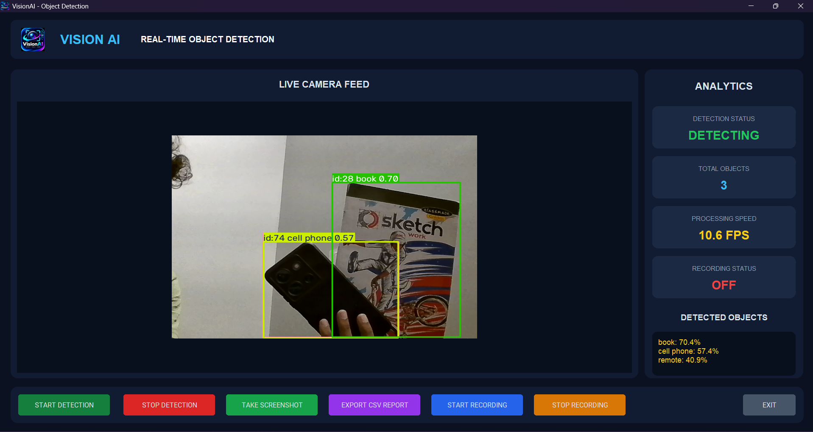

\# VisionAI – Real-Time Object Detection


A real-time object detection application built using \*\*Python, YOLOv8, OpenCV, and CustomTkinter\*\*. VisionAI detects and tracks objects through a webcam and provides a user-friendly graphical interface.


\## Features


\- Real-time object detection using YOLOv8n

\- Live webcam video processing

\- Object tracking using ByteTrack

\- Real-time object counting

\- Confidence percentage display

\- Detection history with timestamps

\- Video recording and saving

\- Screenshot capture

\- CSV report generation

\- Professional dark-themed GUI

\- Custom application logo and splash screen

\- Windows executable support


\## Technologies Used


| Technology | Purpose |

|---|---|

| Python | Core programming language |

| YOLOv8 | Object detection |

| OpenCV | Image and video processing |

| ByteTrack | Object tracking |

| CustomTkinter | Graphical user interface |

| Pillow | Image handling |

| CSV | Detection report export |

| PyInstaller | Executable packaging |


\## Project Structure


```text

VisionAI/

│

├── gui.py

├── image\_detection.py

├── realtime\_detection.py

├── model\_test.py

├── yolov8n.pt

├── VisionAI.ico

├── VisionAI\_icon.png

├── requirements.txt

├── bus.jpg

├── screenshots/

├── reports/

└── README.md

```


\## Installation and Setup


\### 1. Clone the repository


```bash

git clone https://github.com/varunkumar1239/VisionAI-Real-Time-Object-Detection.git

```


\### 2. Navigate to the project folder


```bash

cd VisionAI-Real-Time-Object-Detection

```


\### 3. Create a virtual environment


```bash

python -m venv .venv

```


\### 4. Activate the environment (Windows)


```bash

.venv\\Scripts\\activate

```


\### 5. Install dependencies


```bash

pip install -r requirements.txt

```


\### 6. Run VisionAI


```bash

python gui.py

```


\## How It Works


1\. The webcam captures live video.

2\. OpenCV processes the video frames.

3\. YOLOv8 detects objects in each frame.

4\. ByteTrack tracks detected objects across frames.

5\. The GUI displays object names, confidence scores, and counts.

6\. Users can record videos, capture screenshots, and export detection reports.


## Application Screenshots

### Main Interface



\## Future Enhancements


\- Custom-trained object detection models

\- Improved detection accuracy

\- Multiple camera support

\- Advanced analytics and visualization

\- Cloud-based detection and monitoring


\## Author


\*\*Varun Kumar\*\*


B.Tech – Computer Science and Engineering (Artificial Intelligence and Machine Learning)


GitHub: https://github.com/varunkumar1239


\---


⭐ If you find this project interesting, consider giving it a star!

